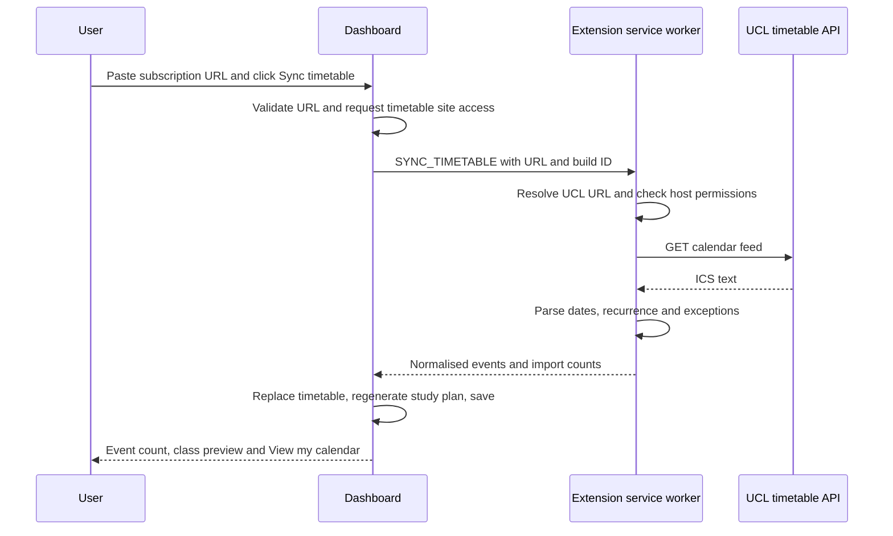

# 1. Calendar connection

This guide explains how Study Space 1.2.0 turns a UCL timetable subscription link into classes in the planner. The connection runs entirely in the Chrome extension; calendar downloads do not use the Gemini backend.

## The basic approach

A subscription link returns an iCalendar document, usually called an ICS feed. Its `VEVENT` records describe appointments, including their titles, dates, times, locations and recurrence rules. We download that document, parse it, and convert its appointments into the planner’s event model.



## Where the code lives

| File | Responsibility |
| --- | --- |
| [src/ical.js](../src/ical.js) | Validate subscription URLs, resolve the UCL endpoint, parse ICS and normalise appointments. |
| [src/background.js](../src/background.js) | Download the feed from the extension service worker and return parsed events. |
| [src/dashboard.js](../src/dashboard.js) | Handle the button, show progress/results, update workspace state and trigger scheduling. |
| [src/dates.js](../src/dates.js) | Convert and display dates in London time. |
| [src/protocol.js](../src/protocol.js) | Share timetable host permissions and the dashboard/worker build ID. |
| [manifest.json](../manifest.json) | Declare access to the two UCL timetable hosts. |

## 1. Accept and resolve the subscription URL

`validateCalendarUrl()` accepts recognised HTTPS paths on:

- `timetable.apps.ucl.ac.uk`
- `timetable.mesh.ucl.ac.uk`

A pasted `webcal:` scheme is converted to `https:`. URLs containing a username/password, a nonstandard port, an unrelated hostname or an unrecognised calendar path are rejected.

UCL’s original subscription format is:

```text
https://timetable.apps.ucl.ac.uk/icalendar/<PRIVATE_ID>
```

The observed response redirects with HTTP 307 to:

```text
https://timetable.mesh.ucl.ac.uk/online-timetable-api-proxy/v0.1/icalendar?key_identifier=<PRIVATE_ID>
```

`calendarFetchUrl()` converts the original format directly into that API URL. It uses `URL.searchParams` to encode the identifier. A direct API URL can also be pasted without conversion. These examples deliberately contain placeholders rather than a real subscription identifier.

The initial redirect fix was insufficient because the API path also needed to pass URL validation. The implementation now recognises both formats and validates the final response URL too.

## 2. Download from the extension

`syncTimetableFromForm()` requests access to the two timetable hosts through `chrome.permissions.request()`. This happens inside the user’s button/form action. If access was already granted, another permission prompt is unnecessary.

The dashboard then sends a `SYNC_TIMETABLE` message. The service worker checks that access is granted and makes this request:

```js
await fetch(url, {
  credentials: 'omit',
  redirect: 'follow',
  cache: 'no-store',
  headers: {
    Accept: 'text/calendar, text/plain;q=0.9, */*;q=0.5'
  },
  signal: AbortSignal.timeout(20000)
});
```

This request is made from the extension worker, which has the declared host access. It is not made from an ordinary website or Moodle content script.

The subscription identifier supplies access to this feed; the request does not send Moodle cookies or require a Moodle session. The code checks the HTTP status, validates the final URL, reads the body as text, and rejects downloaded text longer than 10,000,000 JavaScript string units.

Messages include a shared build ID. A dashboard and worker from different builds produce a reload message instead of silently accepting incompatible responses.

## 3. Parse the ICS document

`parseTimetable()` uses the locally bundled `ical.js` package. Splitting lines manually would miss parameterised dates, folded lines, escaped punctuation and repeating appointments.

For example, an illustrative record might be:

```ics
BEGIN:VEVENT
UID:example-lecture
DTSTART;TZID=Europe/London:20261019T100000
DTEND;TZID=Europe/London:20261019T110000
SUMMARY:Algorithms lecture
LOCATION:Roberts G06
END:VEVENT
```

The parser:

1. Checks for a `VCALENDAR` document.
2. Registers any embedded `VTIMEZONE` definitions.
3. Separates original events from `RECURRENCE-ID` exceptions.
4. Associates exceptions with their original event by `UID`.
5. Expands repeating events with an occurrence iterator.
6. Applies exclusions and occurrence overrides through `ical.js`.
7. Skips cancelled events and invalid/nonpositive intervals.
8. Keeps occurrences that overlap the import window, removes duplicate generated IDs, and sorts by start time.

A recurrence expansion is limited to 50,000 iterations per series. Exceeding the limit produces an error instead of an incomplete import. Detached exception records are also collected for processing when their original series is absent; this unusual export case does not have a dedicated automated test.

UTC values remain UTC instants. Embedded timezone definitions are used where available. Otherwise, a supplied timezone identifier is interpreted using the browser’s timezone support. Floating dates and all-day dates default to London time. Storage uses ISO date strings; the interface displays Europe/London time, including BST/GMT changes.

### Exact import window

The worker passes midnight seven London calendar days before today as `from`. The parser defaults `to` to 120 calendar days after `from`.

Therefore the current code imports a 120-day window containing a one-week lookback and approximately 113 days ahead. Some interface copy describes this as “the next 120 days”; that label is broader than the implemented forward range. This is separate from the scheduler’s 28-day planning horizon.

## 4. Convert records into planner events

The example record becomes:

```json
{
  "id": "timetable-example-lecture-2026-10-19T09:00:00.000Z",
  "title": "Algorithms lecture",
  "start": "2026-10-19T09:00:00.000Z",
  "end": "2026-10-19T10:00:00.000Z",
  "location": "Roberts G06",
  "allDay": false,
  "source": "ucl-timetable"
}
```

On that date London is one hour ahead of UTC, so a 10:00 lecture is stored as 09:00Z.

The generated ID combines the event UID and occurrence start. Each appointment in a recurring series can therefore be displayed separately. Real timetable imports currently do not infer a Moodle `courseId` from a class title.

## 5. Save and show the result

After a successful download and parse, `replaceTimetable()` replaces `state.events`, stores the subscription URL and sync timestamp, regenerates study blocks, and saves the workspace to `chrome.storage.local`.

The dashboard displays the imported count and up to four upcoming classes. **View my calendar** selects the week of the next upcoming event and opens the weekly view. Saving preferences with a new subscription URL also starts the download; it does not just store an unused link.

The first successful real integration clears the sample workspace before adding real data. A later timetable sync preserves existing live tasks while replacing the timetable snapshot.

## Failures, privacy and refresh behaviour

Timeouts, denied access, network failures, unsuccessful HTTP responses and parsing errors are reported beside the subscription controls. A failed download/parse does not replace the existing timetable. A valid feed containing no events in the selected range is treated as a successful empty import and gets a specific explanation.

The private URL is saved locally in the extension and is not hardcoded into project files. The raw feed is processed in memory rather than persisted as an ICS file. Clearing saved data removes the saved URL and normalised events.

This implementation stores a subscription URL but refreshes it manually through **Sync timetable**. There is no scheduled background polling. An `.ics` file can also be imported; it follows the same parsing path but is a snapshot with no saved subscription URL. File imports are limited to 10,000,000 bytes.

## What was verified

The actual UCL subscription was tested on 16 October 2026 using a clean, isolated Chromium extension profile. The response contained 165 `VEVENT` records; 102 events were retained by the import window, saved, and displayed. Those counts describe that test, not a permanent expected feed size.

Automated coverage in [tests/planner.test.js](../tests/planner.test.js) checks recurrence, exclusions, overrides, cancellations, timezones, all-day events and URL handling. [tests/browser.mjs](../tests/browser.mjs) checks the message/import flow with simulated responses, class previews, visible network errors, preservation of previous data, and importing when saving a new URL.

For how imported appointments block study time, see [UI design and data assignment](03-ui-and-data-assignment.md).
