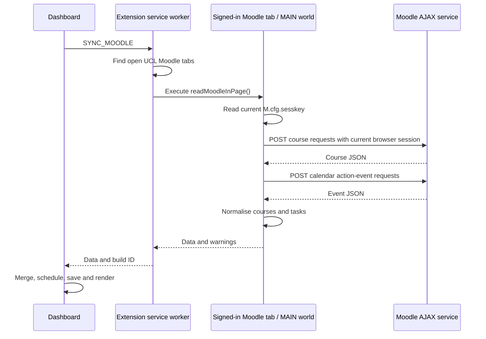

# 2. Moodle connection

This guide explains how Study Space 1.0.1 reads enrolled modules and actionable calendar events using the student’s existing UCL Moodle browser session.

## Why the connection uses an extension

The planner dashboard has a different origin from `moodle.ucl.ac.uk`. It cannot simply read Moodle’s page variables or assume it can use Moodle’s browser session as an ordinary web application.

The implementation instead runs a short read operation inside an existing, signed-in Moodle tab. That function can access Moodle’s current page configuration and make same-origin requests. Only the resulting course/task data is returned to the extension.



## Where the code lives

| File | Responsibility |
| --- | --- |
| [src/moodle.js](../src/moodle.js) | `readMoodleInPage()`, its internal AJAX helper, pagination and data normalisation. |
| [src/background.js](../src/background.js) | Locate Moodle tabs, inject the function and return its result. |
| [src/dashboard.js](../src/dashboard.js) | Start sync, merge incoming records with local edits, regenerate and persist. |
| [manifest.json](../manifest.json) | Declare `scripting`, `storage` and the Moodle host permission. |
| [src/protocol.js](../src/protocol.js) | Detect dashboard/worker build mismatches. |

## 1. Locate an authenticated Moodle page

When the student clicks **Sync Moodle**, the worker runs:

```js
const tabs = await chrome.tabs.query({
  url: 'https://moodle.ucl.ac.uk/*'
});
```

If no matching tab exists, the dashboard asks the student to open Moodle and sign in. The worker tries matching tabs with active tabs first, continuing if an injection fails or the page cannot supply a usable session.

The current implementation does not install a continuously running Moodle content script. It uses an on-demand injection:

```js
await chrome.scripting.executeScript({
  target: { tabId: tab.id },
  world: 'MAIN',
  func: readMoodleInPage
});
```

`MAIN` is necessary because Moodle’s `window.M` belongs to the page’s JavaScript environment. An ordinary isolated content-script world cannot directly access that page global.

`readMoodleInPage()` contains its helper functions inside its own body. Chrome serialises the injected function; it cannot rely on the extension module’s surrounding imports or variables.

## 2. Use the current session without copying cookies

The injected function reads:

```js
const sesskey = window.M?.cfg?.sesskey;
```

The two relevant pieces of authentication have different roles:

| Item | Role | How this implementation handles it |
| --- | --- | --- |
| Moodle session cookie | Identifies the signed-in browser session. | The browser sends it with the same-origin request. The extension does not manually read or store it. |
| `sesskey` | Moodle’s current session/CSRF key. | Read inside the page for each sync and used in its AJAX requests. It is not persisted or included in the returned course/task data. |

The session key is not a standalone bearer token. The page request also depends on the authenticated browser session. A missing key produces a sign-in instruction rather than falling back to a hardcoded value.

Because the function runs in the page’s MAIN world, it shares that page’s JavaScript environment. The implementation limits injection to the declared UCL Moodle origin and uses it for these read operations.

## 3. Call Moodle’s structured AJAX service

The nested `moodleCall(methodname, args)` helper builds a URL relative to the current Moodle origin:

```text
/lib/ajax/service.php?sesskey=<CURRENT_SESSION_KEY>&info=<METHOD_NAME>
```

The request is a JSON POST. Its body follows Moodle’s batched-service format, even though each request here contains one call:

```json
[
  {
    "index": 0,
    "methodname": "core_calendar_get_action_events_by_timesort",
    "args": {
      "timesortfrom": 0,
      "limitnum": 50,
      "aftereventid": 0
    }
  }
]
```

The helper sets `credentials: 'include'`, sends `Content-Type: application/json` and `X-Requested-With: XMLHttpRequest`, and applies a 20-second timeout to each request. It checks HTTP failures, rejects responses that cannot be parsed as JSON, and checks Moodle’s first result for an API error before returning `result[0].data`.

The source of course/event data is structured JSON. The small HTML-to-text conversion in the normaliser removes formatting and decodes entities in returned labels; it is not scraping course information from the Moodle screen.

## 4. Retrieve modules and calendar actions

### Enrolled modules

The method is:

```text
core_course_get_enrolled_courses_by_timeline_classification
```

Arguments request all classifications, alphabetical ordering by full name, and selected fields including `id`, `fullname` and `shortname`. Pagination uses `offset` and `limit: 50`, with a maximum of 1,000 requested course records. It stops on a short page or `nextoffset === -1` and warns if the limit is reached.

Each course is reduced to:

```json
{
  "id": 101,
  "name": "Example Computing Module",
  "shortname": "COMP-EXAMPLE"
}
```

### Actionable calendar events

The method is:

```text
core_calendar_get_action_events_by_timesort
```

The function requests 50 records at a time, beginning with `timesortfrom: 0`. Later requests pass the previous page’s final event ID as `aftereventid`. A set of seen IDs prevents repeated records from being added twice. Pagination stops on a short page, a page with no new IDs, or a limit of 20 pages; hitting the page limit produces a warning.

This endpoint supplies calendar actions exposed by Moodle. It does not enumerate every course document, resource, activity or assessment.

## 5. Assign Moodle fields to the task model

| Planner field | Assignment rule |
| --- | --- |
| `id` | `moodle-` followed by the event ID. |
| `courseId` | `event.course.id`, falling back to `event.courseid`, then `0`. |
| `courseName` | The enrolled course’s short name, then the event’s course short name, then `Moodle`. |
| `title` | The event name converted to plain text. |
| `type` | `assign` becomes `assignment`; `quiz` becomes `quiz`; otherwise `other`. |
| `dueDate` | Positive `timestart`, falling back to `timesort`, converted from Unix seconds to an ISO string; otherwise `null`. |
| `url` | `event.action.url`, falling back to `event.url`. |
| `estimatedMinutes` | 60 for quizzes; 120 for assignments and other event types. |
| `completed` | Initially `false`; local completion is merged afterwards. |
| `source` | `moodle`. |

Events explicitly marked `action.actionable === false` are excluded. The course lookup uses numeric IDs rather than attempting to match module names.

The work estimates are editable defaults, not values learned from the student or supplied as workload estimates by Moodle. Similarly, mapping calendar timestamps to `dueDate` is a practical approximation: the implementation does not separately inspect each activity’s assessment settings to prove that every returned action is a submission deadline.

## 6. Merge with existing local work

On a successful sync, the dashboard replaces the course list and reconciles Moodle tasks by their stable IDs:

- Personal tasks remain in the workspace.
- Incoming Moodle records refresh their titles, module information, deadlines and links.
- Existing work estimates and local completion flags are preserved for matching IDs.
- Completed Moodle tasks absent from the new response remain as local history.
- Unfinished Moodle tasks absent from a successful new response are removed from the current snapshot.

The task editor therefore keeps Moodle titles, modules and deadlines read-only while allowing estimate changes. Completing a task updates the planner only; it does not submit an assignment, mark a Moodle activity complete or write anything back to Moodle.

If the workspace is still in demo mode, a successful real integration first replaces the sample workspace. The merged result is then scheduled, saved under the `workspace` key in `chrome.storage.local`, and rendered.

## Failure handling and scope

If the course request fails, the sync fails and the existing live workspace remains unchanged. If courses succeed but calendar actions fail, the injected function returns `tasks: null` with a warning. The dashboard updates the courses while keeping existing live deadlines. The worker may try another matching Moodle tab when a page-level read fails; if none succeeds, it returns a general refresh/sign-in message.

The worker accepts messages from this extension’s dashboard URL and attaches a build ID to responses. The dashboard rejects a missing or mismatched worker build ID. The background script also requests that local storage access be limited to trusted extension contexts.

The extension does not store session keys or manually access cookies. Persisted data consists of normalised courses/tasks and the rest of the local workspace. Moodle links opened from the task detail view are restricted to HTTPS URLs on `moodle.ucl.ac.uk`.

## What was verified

[tests/browser.mjs](../tests/browser.mjs) exercises the complete injection/message/UI path using a simulated Moodle page and JSON responses in an isolated Chromium profile. It checks course-label decoding, task creation, sample-data removal, estimate persistence, and absence of the synthetic session key from saved workspace data.

That verifies the integration mechanics. It is not a live test against the student’s authenticated Moodle account; actual UCL API availability and the completeness of returned deadlines still depend on that account and Moodle’s configuration.

For how the resulting tasks receive study time, see [UI design and data assignment](03-ui-and-data-assignment.md).
