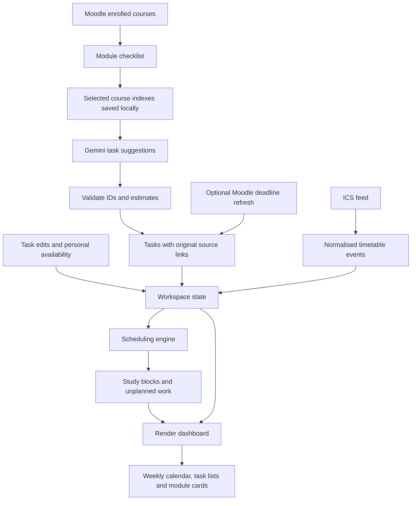

# 3. UI design and data assignment algorithm

This guide explains how Study Space 1.2.0 presents the planner, assigns incoming data to its internal models, and allocates tasks to study sessions. “Assignment” here covers both field mapping and the scheduling of study time.

The interface uses HTML, CSS and JavaScript modules. Rendering, commands and scheduling run locally. Gemini analyses course metadata through a separate local backend. `esbuild` bundles the application and its calendar dependency into files that Chrome can load locally.

## Source map

| File | Responsibility |
| --- | --- |
| [dashboard.html](../dashboard.html) | Page structure, forms, dialogs and reusable SVG icon symbols. |
| [styles.css](../styles.css) | Colours, typography, layout, calendar blocks and responsive behaviour. |
| [src/dashboard.js](../src/dashboard.js) | Workspace state, event handlers, rendering, integration results and persistence. |
| [src/modules.js](../src/modules.js) | Apply saved module choices to the tasks considered by the planner. |
| [src/scheduler.js](../src/scheduler.js) | Allocate unfinished tasks to free intervals. |
| [src/commands.js](../src/commands.js) | Interpret the supported local text commands. |
| [src/dates.js](../src/dates.js) | London dates, week boundaries and formatting. |
| [src/demo.js](../src/demo.js) | Explicit sample data and creation of an empty live workspace. |
| [scripts/build.mjs](../scripts/build.mjs) | Bundle JavaScript and prepare the unpacked extension. |

## UI design

### Layout and hierarchy

The toolbar action opens `dashboard.html` in a normal browser tab. If that dashboard is already open, the worker focuses its existing tab and window.

The page has three main layers:

1. **Navigation:** a sidebar for My week, All tasks, My modules and Preferences. Module shortcuts filter the task list by course ID.
2. **Planning:** summary cards, a weekly calendar and a Coming up list. The upcoming list takes the first four unfinished tasks in deadline order.
3. **Adjustment:** task/event dialogs, connection preferences and a local command box for changing availability or task status.

The weekly calendar receives the most space because the central question is when work will happen. Deadlines remain beside it, and the adjustment controls sit nearby. The timetable connection shows progress, errors and a preview of actual classes so a successful import is visible before leaving Preferences.

### Visual system

A restrained palette separates information without making every appointment compete for attention:

| Use | Treatment |
| --- | --- |
| Page | Off-white background, `#f7f8f5`. |
| Cards and dialogs | White surfaces with pale borders. |
| Primary actions | Muted green, `#566d48`. |
| Timetable appointments | Pale green blocks. |
| Generated study sessions | Pale lavender blocks. |
| Personal blocked time | Pale peach blocks. |
| Module identity | Small coloured dots drawn from a six-colour array. |

Large headings use a system serif font; controls and detail text use system sans-serif fonts. Icons and the plant mark are local SVG assets. No external fonts or image downloads are needed.

Module dot colours are assigned using the module’s position in `state.courses`, wrapping after six colours. They are not persistent hashes of course IDs and can change if the course ordering changes. Event block colours indicate their source rather than their module.

### Responsive behaviour and interactions

CSS Grid gives the calendar most of the desktop width and places deadlines in a second column. On narrower screens those cards stack; on phones, navigation becomes an icon rail. The calendar keeps a minimum internal width and scrolls horizontally rather than compressing seven days into unreadable columns. The sidebar scrolls vertically on short laptop windows.

Controls use native buttons, labelled forms and `<dialog>` elements. Icon-only actions have accessible names, status areas use live announcements, and reduced-motion preferences disable animations. These are implementation features rather than a claim of a formal accessibility audit.

## Data models and ownership

The dashboard holds one `state` object. Its main collections deliberately represent different kinds of information:

| State field | Contents | Owner/source |
| --- | --- | --- |
| `courses` | Module IDs, names and short names. | Moodle sync. |
| `tasks` | Reconciled work, estimates, deadlines and completion flags. | Source metadata, validated Gemini suggestions and local edits. |
| `courseContent` | Per-course normalised index, content fingerprint, fetch date, saved analysis and usage. | Selected course fetches and Gemini responses. |
| `moodleCalendarTasks` | Last successfully fetched calendar actions, before deduplication. | Optional Moodle deadline refresh. |
| `events` | Fixed timetable appointments. | Subscription or ICS import. |
| `blocked` | Personal unavailable intervals. | Local commands and removals. |
| `blocks` | Generated study sessions linked to tasks. | Scheduling engine. |
| `unscheduled` | Task IDs, remaining minutes and reasons. | Scheduling engine. |
| `excludedCourseIds` | String course IDs excluded from the plan. Empty/missing means all modules included. | My modules checkboxes and bulk controls. |
| `preferences` | A requested study date keyed by task ID. | Move commands; cleared when editing that task. |
| `settings` | Study hours, block length, break length, weekend policy and horizon. | Preferences form. |
| `messages` | Recent local command conversation. | Command interface. |

The object also stores its schema version, demo/live mode, saved calendar URL and sync timestamps. Dates are serialised as ISO strings so the workspace can be persisted as ordinary JSON-compatible data.

The extension saves under `chrome.storage.local.workspace`. A normal browser preview uses `localStorage` instead and cannot perform live extension requests. Persistence failures produce a warning; the in-memory workspace remains usable for that page session.

A missing or unusable saved workspace starts with labelled sample data. The first successful real integration creates an empty live workspace before adding its results. This avoids mixing sample lectures or assignments with the student’s data. Initial sample plans include earlier days of the sample week; later regeneration uses the actual current time.

## Assigning imported data to the UI



The [Moodle connection guide](02-moodle-connection.md) explains the exact incoming field mappings. The key relationship is `task.courseId → course.id`; names are display labels, not join keys.

Each generated session copies the task’s `courseId`, `courseName` and title, and stores `taskId`. Clicking that session can therefore find its original task, show its deadline and estimate, and offer completion or editing controls. Reopening or completing a task causes a new plan to be generated.

Imported timetable events do not currently receive a Moodle course association. Their title and location appear directly from ICS, and their start/end times block study allocation regardless of module identity. No fuzzy matching of timetable titles to Moodle names is implemented.

The renderer combines:

```js
[...state.events, ...state.blocks, ...state.blocked]
```

It keeps intervals overlapping the selected Monday-to-Sunday week. The `source` field chooses the visual treatment: `ucl-timetable`, `study` or `personal`. Rendered user/provider labels are escaped before being placed into HTML.

### How summary values are calculated

| Display | Calculation |
| --- | --- |
| Focus time this week | Sum of durations of generated study blocks overlapping the selected week. |
| Focus session count | Number of those study blocks. |
| To-do count | Unfinished tasks in included modules plus independent personal tasks, not just this week’s deadlines. |
| Completed count | Number of completed tasks currently considered by module selection. |
| Plan health | Number of tasks with remaining unscheduled work across the planning horizon. |
| Module progress | Completed task count divided by total task count for that course. |

“Looking balanced” means no task has unscheduled minutes in the current generated plan. It is not a separate measure of daily workload distribution or wellbeing.

## Assigning times to calendar blocks

The weekly view uses a time-axis column followed by seven day columns. The visible time range begins at the earlier of 08:00 and the configured study start, and ends at the later of 19:00 and the configured study end.

The main scale is one CSS pixel per minute. For each event overlapping a visible day:

```text
top = minutes from that day’s visible start to the event start
bottom = minutes from that day’s visible start to the event end
height ≈ bottom − top
```

The positions are clipped to the displayed day interval. Small sessions get a compact presentation; longer blocks can also show their location or module. Multi-day and all-day appointments are drawn in each visible day they overlap. There is no separate all-day strip.

For simultaneous events, the renderer groups connected overlaps, sorts them by start time, and assigns each to the first lane whose previous event has ended. The group’s lane count determines each block’s horizontal width. This makes conflicting classes visible side by side; it does not resolve or move university appointments.

A current-time line is refreshed every minute while the weekly view is visible. Updating that marker does not regenerate the study plan.

## The scheduling algorithm

`scheduleTasks()` in [src/scheduler.js](../src/scheduler.js) is a deterministic greedy allocator for the supplied inputs and `now` value. It gives earlier deadlines first access to free time, then fills the earliest usable gaps.

### Default constraints

| Setting | Default |
| --- | --- |
| Study hours | 09:00–18:00, London time. |
| Focus block | One continuous 120-minute sheet or 150-minute lecture-content task; longer work uses two-hour blocks and a final remainder. |
| Break between study blocks | Prefer 10 minutes, omitted only when necessary in the current planner. |
| Weekends | Excluded. |
| Planning horizon | 28 calendar days from today. |

The scheduler accepts settings as inputs rather than reading the interface or storage itself. It returns `{ blocks, unscheduled }`, which makes the algorithm independently testable.

### Step 1: Prepare priorities and occupied intervals

Before calling the allocator, `schedulableTasks(state)` removes work belonging to excluded modules, optional work left outside the plan, and tasks still needing an estimate. All timetable events still enter the occupied intervals, and independent personal tasks remain eligible. Module exclusions preserve imported tasks and local estimates/completion flags; changing a checkbox saves the choice and rebuilds the plan. The first Moodle sync opens this selection view, and saved exclusions persist across subsequent syncs.

Completed tasks are excluded. Gemini provides workload estimates and can propose calendar slots. `src/planner/planning.js` validates these proposals and applies travel/location constraints. The allocator below remains the legacy deadline-first algorithm; see [the planner API](04-planner-api.md) for the shared service, current fallback, daily cap and weekly personal events. Remaining tasks are sorted by ascending deadline; tasks without a deadline come last. Equal deadlines are resolved by task ID.

Existing timetable events and personal-time blocks become occupied intervals. Invalid or nonpositive occupied intervals are discarded. Previously generated study blocks are not supplied as fixed commitments: the new run rebuilds them.

Each task starts with its rounded estimated minutes. An undated task uses the planning horizon as its allocation cutoff. Invalid deadlines produce an unscheduled result rather than calendar blocks.

### Step 2: Inspect eligible days

For each task, inspect days from today through the horizon:

- Skip weekends unless enabled.
- If the task has a date preference, consider only that date.
- Start no earlier than now, that day’s study-start time, and the source section’s recognised teaching-week start. Undated work from weeks beyond the planning horizon stays in the backlog.
- Round that initial daily cursor up to the next five-minute boundary.
- End at the earliest of the study-end time, task deadline and planning horizon.

Later gap starts can come directly from an appointment’s end time; the code does not round every possible session start to a five-minute grid.

### Step 3: Find free gaps

For the eligible interval, sort intersecting occupied intervals by start time. Walk through them, recording the space before each interval and moving the cursor to the furthest occupied end encountered. This also handles overlapping busy appointments without counting overlapping time as free.

If the cursor has not reached the day’s cutoff, the remaining tail of the day becomes another free gap.

### Step 4: Allocate focus sessions

Tasks of 150 minutes or less stay in a single continuous event using their full estimated duration. Longer tasks use 120-minute blocks and a final remainder. A gap must fit the whole required block; small gaps are skipped, rather than turning a two-hour sheet into scattered short sessions. The current planner tries placing a break between study blocks first and retries without that optional break only when no placement with a break fits. AI output is validated against the same continuous-block rule.

Each session contains its task link and display fields:

```js
{
  id: `study-${task.id}-${slot}`,
  taskId: task.id,
  courseId: task.courseId,
  courseName: task.courseName,
  title: task.title,
  start: new Date(slot).toISOString(),
  end: new Date(slot + length * 60000).toISOString(),
  source: 'study'
}
```

After placing a session, the allocator adds its interval plus the following break to the occupied list, subtracts the session duration from remaining work, and moves on. Breaks reserve availability internally; they are not separate calendar cards.

The break reservation can extend past the focus-session cutoff. The focus session itself is bounded by the deadline and study hours; breaks are not separately clipped or optimised.

### Step 5: Report work that does not fit

If there are minutes left after scanning eligible days, return a record such as:

```json
{
  "taskId": "example-assignment",
  "minutes": 70,
  "reason": "Not enough free time before the deadline"
}
```

Other reasons include an invalid deadline, a passed deadline, or insufficient room on a preferred day. The All tasks view shows the task title, remaining minutes and reason. The algorithm does not silently extend work beyond its deadline.

### Worked example

Suppose a sheet requires 120 minutes, is due Monday at 17:00, and planning begins Monday at 09:00. There is a lecture from 10:00 to 11:30. The 09:00–10:00 gap is too short, so the sheet is scheduled as one 11:30–13:30 block. A following study block preferably starts at 13:40, allowing a ten-minute break.

If the same sheet instead has a 10:00 deadline, it is left entirely unscheduled (120 minutes remaining). The planner does not squeeze a fragment into the hour before its deadline.

## Reviewing extracted work

The module view shows which course indexes are saved and whether their analysis is current. Fetching and analysis have separate progress and error states: failure keeps saved content and previous tasks. Each successful course is persisted independently.

A task records its source activity ID/URL, section, Moodle completion status, Gemini category, estimate, confidence and reasoning. The editor shows these details and opens the original Moodle resource. Estimates appear with `~` when supplied by Gemini. Optional tasks remain visible with an **Optional** badge and start outside the calendar; the student can opt them in. A missing workload estimate appears as **Estimate needed** until edited. Completion updates this planner, without submitting work or changing Moodle.

Names and estimates from the model cannot choose arbitrary URLs or invent dates: source IDs resolve to saved activity records. Moodle deadlines are merged by course/activity ID. Local estimate, inclusion and completion overrides survive later imports.

## How edits and commands trigger reassignment

The common update path is:

```text
change state → regenerate blocks → persist workspace → render views
```

Task creation, estimate changes, completion/reopening, timetable imports, preference changes and personal-time changes use this path. Manual **Regenerate plan** also uses the current time. Merely navigating weeks or reopening a saved workspace does not recompute the plan.

The command box uses [src/commands.js](../src/commands.js), with three rule-based operations:

| Example | State change |
| --- | --- |
| “I’m busy Wednesday afternoon” | Add a personal interval, 12:00–18:00, then regenerate. |
| “Finished maths problem sheet” | Find an unfinished task, mark it complete, then regenerate. |
| “Move maths problem sheet to Friday” | Set that task’s preferred date, then regenerate. |

Task matching normalises words from the request and compares them with the task title and course label. It chooses the strongest nonzero match and rejects a tie. It is not general natural-language understanding. Ambiguous requests receive a message asking for a more specific task title.

A move is a hard date constraint, not permission to miss a deadline. If the task cannot fit on that date, the remainder is reported. Weekends still require the weekend setting. Saving a task in its editor removes its date preference.

## Current tradeoffs and validation

The allocator is deliberately small enough to inspect and explain during a hackathon. It does not optimise grades, learning retention, energy levels or fairness between modules. Earlier tasks can consume most early gaps, so a valid plan may be concentrated at the beginning of the horizon. It also does not track partial progress within individual sessions or preserve manually positioned sessions across regeneration.

The UI uses the same model for live and demo rendering. It shows fixed commitments and generated work together while keeping their sources distinguishable.

[tests/planner.test.js](../tests/planner.test.js) checks deadline ordering, non-overlap with commitments, break behaviour in representative cases, remaining-minute reports, completion, date preferences, weekends and London clock changes. [tests/browser.mjs](../tests/browser.mjs) checks task editing/completion, persistence, command handling, integration rendering, calendar previews, preference validation and mobile document overflow.
